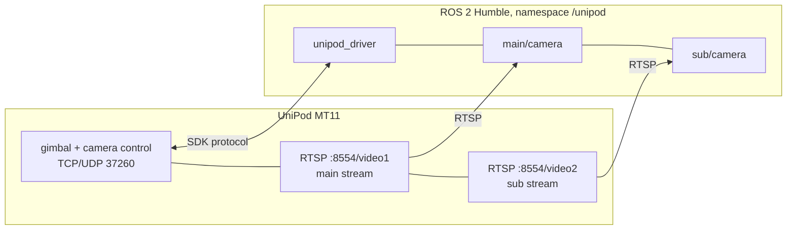

<div align="center">

# unipod_driver

**ROS 2 driver for the Reebot UniPod MT11 quad-sensor pod: pan/tilt, zoom, recenter, both RTSP
streams as images, and the thermal camera's temperatures in °C.**

[](https://github.com/DarmawanRobotics/unipod_driver/actions/workflows/ci.yml)
[](https://docs.ros.org/en/humble/)
[](https://releases.ubuntu.com/22.04/)


[](LICENSE)

[Interface](#interface) · [Network](#network) · [Quick start](#quick-start) · [Usage](#usage) ·
[Parameters](#parameters) · [Verify on the real pod](#verify-on-the-real-pod) · [Develop](#develop)

</div>

---

The MT11 takes commands over the *UniPod MT11 External SDK Protocol*
([docs/UniPod_MT11_External_SDK_Protocol_V0.1.0.pdf](docs/UniPod_MT11_External_SDK_Protocol_V0.1.0.pdf), V0.1.0, frames `0x6655`,
CRC16) on TCP/UDP 37260 or TTL serial, and streams video over RTSP. This package keeps only what
a robot needs from it: PTZ, zoom, video mode, temperatures, palette/gain/shutter and recenter.
AI tracking, laser ranging, recording and the SD card are left out.



## Interface

All names under the launch namespace (`/unipod` by default).

**Topics**

| Topic | Type | |
|---|---|---|
| `ptz_cmd` (in) | `geometry_msgs/Twist` | `angular.z` yaw, `angular.y` pitch, `linear.z` zoom, each −1..1; stops by itself 0.5 s after the last message |
| `attitude` | `unipod_driver/GimbalAttitude` | yaw, pitch, roll (°) and rates (°/s), pushed at `attitude_rate_hz` |
| `status` | `unipod_driver/GimbalStatus` | connected, zoom / zoom max, what each stream carries, palette, gain, firmware |
| `thermal/temperature` | `unipod_driver/ThermalData` | full-frame max/min (°C) and where they are, 5 Hz |
| `main/image_raw` | `sensor_msgs/Image` | `video1`: zoom camera by default |
| `sub/image_raw` | `sensor_msgs/Image` | `video2`: thermal camera by default |
| `*/image_raw/compressed` | `sensor_msgs/CompressedImage` | via image_transport |

**Services**

| Service | Type | |
|---|---|---|
| `set_angle` | `SetGimbalAngle` | absolute yaw (unlimited) / pitch (−90..30°), returns the attitude from the ACK |
| `recenter` | `Recenter` | `1` reset, `2` center + face down, `3` center, `4` face down |
| `zoom` | `ZoomControl` | continuous: `1` in, `0` stop, `-1` out; returns the zoom |
| `set_zoom` | `SetZoom` | absolute 1.0 .. `zoom_max` (30x hybrid) |
| `set_video_mode` | `SetVideoMode` | what `video1` / `video2` carry: zoom + thermal, thermal + zoom, zoom⊕thermal + thermal |
| `get_temperature` | `GetTemperature` | `0` point, `1` box, `2` full frame; °C with pixel positions |
| `thermal_control` | `ThermalControl` | `0` palette, `1` gain (low/high), `2` shutter refresh (FFC) |

Angles follow the pod: NED, **yaw positive right, pitch positive up**. `ptz_cmd` uses the same
signs (`invert_yaw` / `invert_pitch` flip them).

## Network

From the [SDK document](docs/UniPod_MT11_External_SDK_Protocol_V0.1.0.pdf) (chapter 3) and the
[MT11 user manual](https://reebot.com/reebot_file/UniPodMT11/UniPod%20MT11%20User%20Manual%20v1.2%20.pdf):

| | |
|---|---|
| pod IP | `192.168.144.25` (factory); `config/unipod_config.yaml` and the launch use `10.21.31.26` |
| control | TCP or UDP **37260** (TCP needs the 1 Hz heartbeat, the driver sends it), or TTL serial 115200 8N1 |
| main stream | `rtsp://<ip>:8554/video1` |
| sub stream | `rtsp://<ip>:8554/video2` |
| encoding | H.264 or H.265, 1920×1080 / 1280×720; the driver logs what each stream sends at connect |

Give the computer an address in the pod's subnet (e.g. `192.168.144.100/24` for the factory IP)
and check `ping <ip>` before launching.

## Quick start

Ubuntu 22.04, ROS 2 Humble (JetPack 6 on a Jetson).

```bash
# 1. Source and dependencies
mkdir -p ~/ros2_ws/src && cd ~/ros2_ws/src
git clone https://github.com/DarmawanRobotics/unipod_driver.git
cd ~/ros2_ws
rosdep install --from-paths src --ignore-src -y

# 2. Build
colcon build --packages-select unipod_driver && source install/setup.bash

# 3. Launch driver + both streams
ros2 launch unipod_driver unipod_driver.launch.py ip:=10.21.31.26
#   transport:=udp | serial (serial_device:=/dev/ttyUSB0), camera:=false for control only

# 4. Second terminal
ros2 topic echo --once /unipod/status
ros2 run rqt_image_view rqt_image_view /unipod/main/image_raw
```

## Usage

**PTZ**

```bash
# pan right at 30 % while publishing, stops 0.5 s after the publisher ends
ros2 topic pub -r 20 /unipod/ptz_cmd geometry_msgs/msg/Twist "{angular: {z: 0.3}}"

# absolute angle
ros2 service call /unipod/set_angle unipod_driver/srv/SetGimbalAngle "{yaw: 45.0, pitch: -30.0}"

# reset / center / look down
ros2 service call /unipod/recenter unipod_driver/srv/Recenter "{mode: 1}"
ros2 service call /unipod/recenter unipod_driver/srv/Recenter "{mode: 4}"
```

With a joystick: `teleop_twist_joy` remapped to `/unipod/ptz_cmd` (yaw on `angular.z`, pitch on
`angular.y`, zoom on `linear.z` past ±0.5).

**Zoom**

```bash
ros2 service call /unipod/set_zoom unipod_driver/srv/SetZoom "{zoom: 10.0}"
ros2 service call /unipod/zoom unipod_driver/srv/ZoomControl "{command: 1}"   # in ...
ros2 service call /unipod/zoom unipod_driver/srv/ZoomControl "{command: 0}"   # ... stop
```

**Images**

```bash
ros2 topic hz /unipod/main/image_raw     # zoom camera (video1)
ros2 topic hz /unipod/sub/image_raw      # thermal camera (video2)

# thermal full screen on video1, zoom on video2
ros2 service call /unipod/set_video_mode unipod_driver/srv/SetVideoMode \
  "{main_stream: 2, sub_stream: 0}"
```

**Thermal**

```bash
ros2 topic echo /unipod/thermal/temperature                  # frame max/min, 5 Hz

ros2 service call /unipod/get_temperature unipod_driver/srv/GetTemperature \
  "{mode: 0, x: 320, y: 256}"                                # one point
ros2 service call /unipod/get_temperature unipod_driver/srv/GetTemperature \
  "{mode: 1, x: 200, y: 200, x2: 400, y2: 400}"              # a box

ros2 service call /unipod/thermal_control unipod_driver/srv/ThermalControl \
  "{command: 0, value: 0}"                                   # palette: white hot
ros2 service call /unipod/thermal_control unipod_driver/srv/ThermalControl \
  "{command: 2}"                                             # shutter refresh (FFC)
```

Temperature coordinates are thermal image pixels (640×512, 1280×1024 with AI super-resolution);
a box scales with the thermal digital zoom, so use the box the reply reports.

**About "raw" thermal:** the SDK has no radiometric frame (no per-pixel temperature image).
What it gives is the thermal *video* over RTSP and temperatures by point / box / full frame.
For an image without colour mapping, use palette `0` (white hot) with `encoding: mono8` on the
thermal stream's camera node; per-pixel values are then 8-bit intensity (AGC), not °C.

## Parameters

[config/unipod_config.yaml](config/unipod_config.yaml), every one commented.

**Driver** (`unipod_driver`)

| Parameter | Default | |
|---|---|---|
| `transport` | `tcp` | `tcp`, `udp` or `serial` |
| `ip`, `port` | `10.21.31.26`, `37260` | factory IP `192.168.144.25` |
| `serial_device`, `serial_baudrate` | `/dev/ttyUSB0`, `115200` | |
| `request_timeout_ms` | `500` | per attempt, one retry |
| `attitude_rate_hz` | `10` | 2, 4, 5, 10, 20, 50, 100 (0: off) |
| `status_rate_hz` | `1` | status poll |
| `ptz_max_speed` | `100` | speed at full stick, 0..100 |
| `ptz_cmd_timeout` | `0.5` | s without `ptz_cmd` while moving: stop |
| `invert_yaw`, `invert_pitch` | `false` | |
| `main_stream`, `sub_stream` | `0`, `2` | applied at every connect; `-1` leaves the pod alone |
| `thermal_palette`, `thermal_gain` | `-1` | applied at every connect when ≥ 0 |
| `temperature_stream` | `true` | full-frame temperatures at 5 Hz |
| `frame_id`, `thermal_frame_id` | `unipod_gimbal`, `unipod_thermal` | |

**Cameras** (`main/camera`, `sub/camera`; `url` comes from the launch `ip`)

| Parameter | Default | |
|---|---|---|
| `codec` | `auto` | `auto` (decodebin), `h264`, `h265`; set it for the Jetson decoder |
| `decoder` | `auto` | `auto` = jetson (if codec set) → software → ffmpeg; or one of them |
| `latency_ms`, `protocols` | `0`, `tcp` | rtspsrc jitter buffer and transport |
| `reconnect_sec`, `timeout_ms` | `1.0`, `5000` | retry back-off (doubles to 30 s), dead-stream timeout |
| `encoding` | `bgr8` | `bgr8` or `mono8` |
| `max_fps`, `width`, `height` | `0` | 0: as received |

One stream only: add a `/**/sub/camera:` section to your copy of the YAML (`config:=`).

## Verify on the real pod

1. **Link:** `ros2 topic echo --once /unipod/status` shows `connected: true`, firmware and
   `zoom_max: 30.0`. The camera reports `v0.0.0` for the first ~30 s after power-up.
2. **Streams:** the driver log lists `rtsp video1/video2: H265 1920x1080 ...`; set `codec` to
   match when using `decoder: jetson`. `ros2 topic hz /unipod/main/image_raw` and `.../sub/...`.
3. **Video mode:** `status.main_stream: 0`, `sub_stream: 2` (zoom on video1, thermal on video2).
4. **Directions:** `ptz_cmd` `angular.z: 0.3` must pan **right** and `angular.y: 0.3` tilt
   **up**; `attitude.yaw` grows to the right. Otherwise set `invert_yaw` / `invert_pitch`.
5. **Stop:** stop the `ptz_cmd` publisher: the gimbal stops within 0.5 s.
6. **Zoom:** `set_zoom 10.0` then `status.zoom` reads ~10.
7. **Thermal:** point a hand at the camera, `thermal/temperature` `temp_max` near 30–36 °C;
   `get_temperature` on that pixel agrees.
8. **Recenter:** `recenter {mode: 1}` brings the gimbal back to center.

## Develop

```bash
colcon build --packages-select unipod_driver
colcon test --packages-select unipod_driver && colcon test-result --verbose
bash src/unipod_driver/test/smoke_test.sh   # with the workspace sourced
```

- `test_protocol`: every example packet of chapter 4 of the SDK document, byte for byte, and the
  stream parser (resync, bad CRC, split frames)
- `test_client`: request/ACK, decoding, timeouts, pushed streams and reconnects against an
  in-memory pod; `test_transport`: real UDP/TCP on loopback
- `test_rtsp`: GStreamer pipelines, decoder order, the capture loop on a local video
- `smoke_test.sh`: the launch file against [test/fake_pod.py](test/fake_pod.py), every topic and
  service; CI runs all of it in a `ros:humble` container

```
unipod_driver/
├── include/unipod_driver/
│   ├── protocol.hpp        framing, CRC16 (no ROS)
│   ├── transport.hpp       UDP / TCP / serial (no ROS)
│   ├── client.hpp          request/ACK, link supervision, typed API (no ROS)
│   ├── rtsp_capture.hpp    RTSP capture thread (OpenCV, no ROS)
│   └── ...
├── src/
│   ├── unipod_driver_node.cpp
│   └── unipod_camera_node.cpp
├── msg/ srv/               GimbalAttitude, GimbalStatus, ThermalData + 7 services
├── config/unipod_config.yaml
├── docs/                  UniPod MT11 External SDK Protocol (PDF)
├── launch/unipod_driver.launch.py
└── test/
```

The client and capture libraries have no ROS dependency, so they can be reused in a plain C++
program (`unipod_client`, `unipod_rtsp`).

unipod_driver is released under the [Apache License 2.0](LICENSE).
